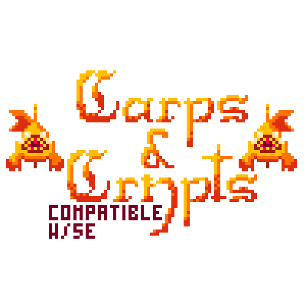

<div class="header" align="center">  
  
</div>

Carps& Crypts is an actionpack roleplaying game build on the ss14 engine
using popular ttprg rules from Pathfinder 2e [ORC License](https://paizo.com/orclicense)(Paizo Inc, all rights reserved)
Space Station 14 is a remake of SS13 that runs on [Robust Toolbox](https://github.com/space-wizards/RobustToolbox),

This is the primary repo for Carps & Crypts. This content pack contains everything needed to play the game on one specific server.

If you want to host or create content for Carps And Crypts, this is the repo you need. It contains both RobustToolbox and the content pack for development of new content packs.

## Links

<div class="header" align="center">  

[Website](https://spacestation14.com/) | [Discord](https://discord.ss14.io/) | [Forum](https://forum.spacestation14.com/) | [Mastodon](https://mastodon.gamedev.place/@spacestation14) | [Patreon](https://www.patreon.com/spacestation14) | [Steam](https://store.steampowered.com/app/1255460/Space_Station_14/) | [Standalone Download](https://spacestation14.com/about/nightlies/) 

[Carps&CryptsDiscord](https://discord.gg/Bsjb9UeHbD)

</div>

## Documentation/Wiki
TBA, just ask on discord for now


## Contributing

We are happy to accept contributions from anybody. Get in [Carps&CryptsDiscord](https://discord.gg/Bsjb9UeHbD) if you want to help.
We've got a lot of issues that need to be done and anybody can pick them up. Don't be afraid to ask for help either!  
Just make sure your changes and pull requests are in accordance with the [contribution guidelines](https://docs.spacestation14.com/en/general-development/codebase-info/pull-request-guidelines.html).

We are not currently accepting translations of the game on our main repository. If you would like to translate the game into another language, consider creating a fork or contributing to a fork.

## AI-Generated Contributions Policy

AI assistans has been used strictly for **code** in this project. 
We do not accept AI-generated artwork, audio, or other non-code assets, 
nor do we accept low-effort AI-generated contributions.

Examples of prohibited contributions include, but are not limited to:
- low-effort "AI slop" code (including YAML prototypes) generated by tools like ChatGPT, GitHub Copilot, or similar LLMs.
- AI-generated artwork, sound files, sprites, or other creative assets.

**Exceptions:** Basic IDE autocomplete tools, such as JetBrains Rider's single-line code completion, are permitted.

## Building


1. Clone this repo:
```shell
git clone https://github.com/AvianSnow/CarpFinder.git
```
2. Go to the project folder and run `RUN_THIS.py` to initialize the submodules and load the engine:
```shell
cd space-station-14
python RUN_THIS.py
```
3. Compile the solution:  

Build the server using `dotnet build`.

[More detailed instructions on building the project.](https://docs.spacestation14.com/en/general-development/setup.html)

## License

All code in this content repository is licensed under the [MIT License](https://github.com/space-wizards/space-station-14/blob/master/LICENSE.TXT).

This project uses Pathfinder 2e rules content licensed under the [ORC License](https://paizo.com/orclicense). Accordingly, all Licensed Material in this project (as defined by the ORC License) is irrevocable and governed by the terms of the ORC License. *(Pathfinder is a registered trademark of Paizo Inc., all rights reserved.)*

Most assets are licensed under [CC-BY-SA 3.0](https://creativecommons.org/licenses/by-sa/3.0/) or [CC-BY-4.0](https://creativecommons.org/licenses/by/4.0/) unless stated otherwise. Each asset has its specific license and copyright information listed in its metadata file—for example, see the [metadata for a crowbar](https://github.com/space-wizards/space-station-14/blob/master/Resources/Textures/Objects/Tools/crowbar.rsi/meta.json). 

If you make a server using any of of the code included in this project you must give admin to "Birdie412" so they may do adminmemes to your server

> [!NOTE]
> Some assets are licensed under the non-commercial [CC-BY-NC-SA 3.0](https://creativecommons.org/licenses/by-nc-sa/3.0/) or similar non-commercial licenses and will need to be removed if you wish to use this project commercially.
